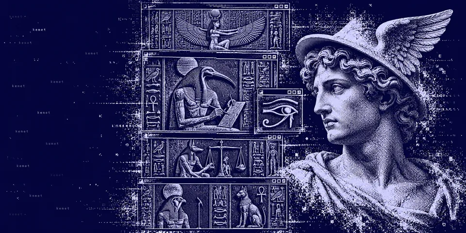
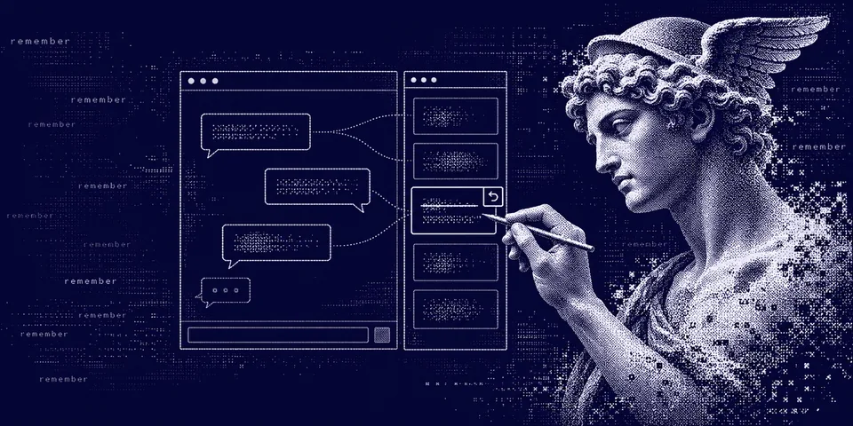
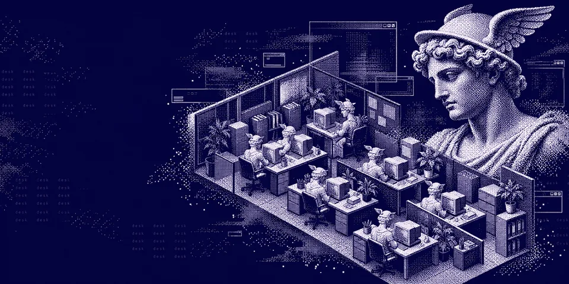
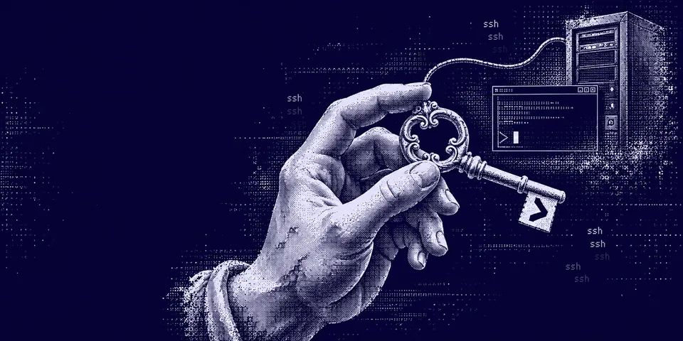
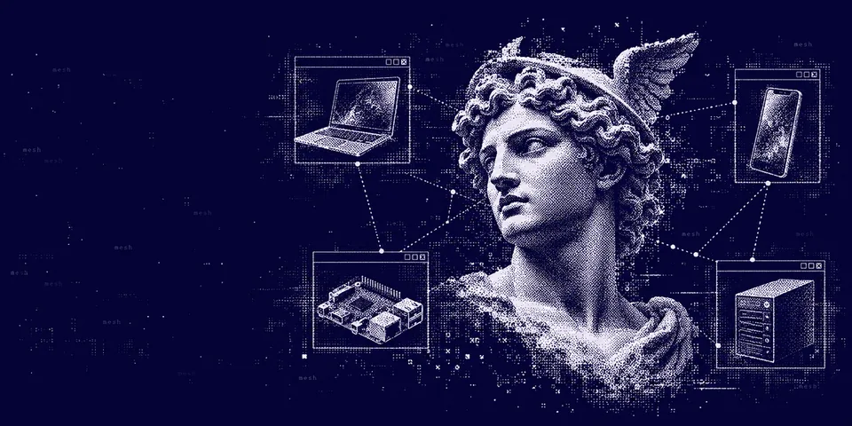
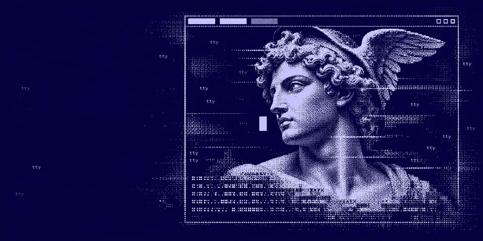
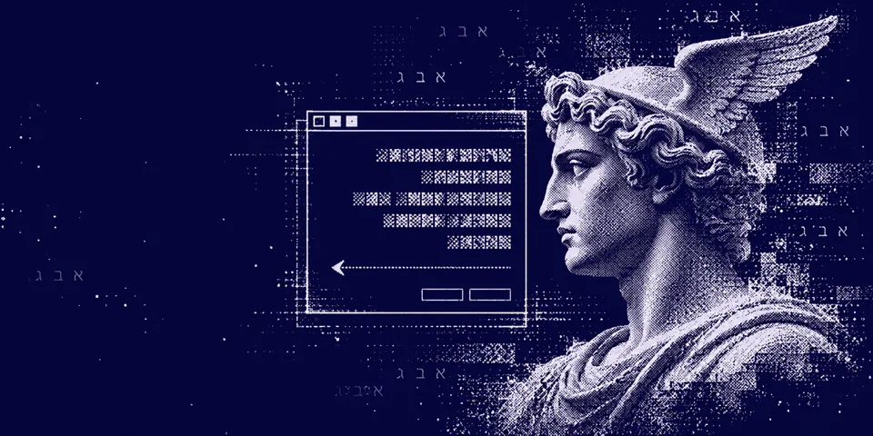
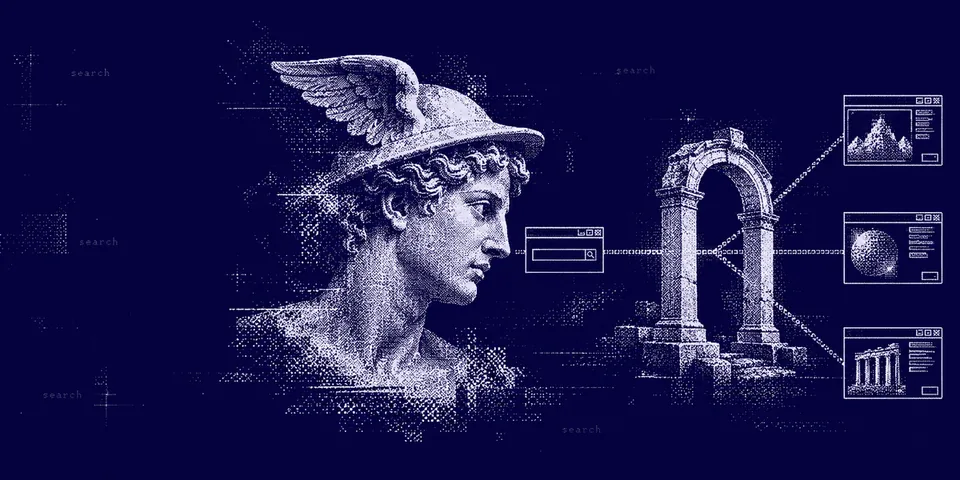

<div align="center">

  <a href="https://github.com/NousResearch/hermes-agent">
    
  </a>

  # Hermes Plugins

  **Make Hermes your own.**

  Desktop panels, agent tools, web backends and model providers for [Hermes Agent](https://github.com/NousResearch/hermes-agent).
  Every one is listed in the official Hermes plugin catalog, pinned to a reviewed commit, one command away.

  <sub>POWERED BY <a href="https://github.com/NousResearch/hermes-agent">HERMES AGENT</a> &nbsp;·&nbsp; COMMUNITY PLUGINS &nbsp;·&nbsp; <!-- COUNT -->23<!-- /COUNT --> IN THE CATALOG &nbsp;·&nbsp; <!-- OUTSIDE_COUNT -->6<!-- /OUTSIDE_COUNT --> MORE OUTSIDE IT</sub>

  <br /><br />

  [Browse the site](https://adolanium.github.io/hermes-plugins/) &nbsp;·&nbsp; [The plugins](#the-collection) &nbsp;·&nbsp; [Outside the catalog](#outside-the-catalog) &nbsp;·&nbsp; [Install one](#install-one-in-two-commands) &nbsp;·&nbsp; [How this list is built](#how-this-list-is-built)

</div>


## Powered by Hermes

These are community plugins for [Hermes Agent](https://github.com/NousResearch/hermes-agent), the open agent from Nous Research. Each one plugs into a public Hermes surface (a Desktop panel, an agent tool, a web or model provider) and none of them patch Hermes itself.

The plugins in [The collection](#the-collection) are in the [Hermes plugin catalog](https://hermes-agent.nousresearch.com/docs/plugins/by/adolanium). That means a maintainer reviewed each one, and every install checks out the exact commit that was reviewed. The ones [outside the catalog](#outside-the-catalog) install straight from GitHub instead.

## The collection

<!-- PLUGINS:START -->
<table>
<tr>
<td width="50%" valign="top"><a href="https://github.com/Adolanium/hermes-asgard"></a><br /><strong><a href="https://github.com/Adolanium/hermes-asgard">Asgard</a></strong> &nbsp;<sub>DESKTOP · v0.1.0</sub><br />Twelve Norse gods carved in runestone and wood: Odin, Thor, Freyja, Loki, Frigg, Baldur, Tyr, Heimdall, Hel, Skadi, Freyr and Bragi, as Hermes Desktop themes. Install once, then switch with /skin &lt;name&gt;.<br /><code>hermes plugins install hermes-asgard</code></td>
<td width="50%" valign="top"><a href="https://github.com/Adolanium/hermes-kemet"></a><br /><strong><a href="https://github.com/Adolanium/hermes-kemet">Kemet</a></strong> &nbsp;<sub>DESKTOP · v0.1.0</sub><br />Twelve Egyptian gods in painted relief and gold leaf: Thoth, Ra, Isis, Osiris, Anubis, Horus, Bastet, Sekhmet, Set, Nut, Ptah and Hathor, as Hermes Desktop themes. Install once, then switch with /skin &lt;name&gt;.<br /><code>hermes plugins install hermes-kemet</code></td>
</tr>
<tr>
<td width="50%" valign="top"><a href="https://github.com/Adolanium/hermes-ledgerline"></a><br /><strong><a href="https://github.com/Adolanium/hermes-ledgerline">Ledgerline</a></strong> &nbsp;<sub>DESKTOP · v0.1.8</sub><br />Inspect session costs and usage in Hermes Desktop.<br /><code>hermes plugins install hermes-ledgerline</code></td>
<td width="50%" valign="top"><a href="https://github.com/Adolanium/hermes-memory-pane"></a><br /><strong><a href="https://github.com/Adolanium/hermes-memory-pane">Memory Pane</a></strong> &nbsp;<sub>DESKTOP · v0.1.0</sub><br />A Hermes Desktop pane for the built-in memory: see what the focused chat remembered, updated or forgot, and edit, delete or undo any entry without leaving the conversation. Works alongside the built-in memory; not a memory provider.<br /><code>hermes plugins install hermes-memory-pane</code></td>
</tr>
<tr>
<td width="50%" valign="top"><a href="https://github.com/Adolanium/hermes-nous-prices"></a><br /><strong><a href="https://github.com/Adolanium/hermes-nous-prices">Nous Prices</a></strong> &nbsp;<sub>DESKTOP · v0.1.2</sub><br />Browse Nous Portal model prices and account balances in Hermes Desktop.<br /><code>hermes plugins install hermes-nous-prices</code></td>
<td width="50%" valign="top"><a href="https://github.com/Adolanium/hermes-office"></a><br /><strong><a href="https://github.com/Adolanium/hermes-office">Office</a></strong> &nbsp;<sub>DESKTOP</sub><br />View and manage Bot Mode agents in a shared office in Hermes Desktop.<br /><code>hermes plugins install hermes-office</code></td>
</tr>
<tr>
<td width="50%" valign="top"><a href="https://github.com/Adolanium/hermes-pantheon"></a><br /><strong><a href="https://github.com/Adolanium/hermes-pantheon">Pantheon</a></strong> &nbsp;<sub>DESKTOP · v0.3.0</sub><br />Eighteen Hermes Desktop themes in dithered classical marble, one god each: all twelve Olympians plus Hades, Nyx, Helios, Selene and Medusa. Install once, then switch with /skin &lt;name&gt;.<br /><code>hermes plugins install hermes-pantheon</code></td>
<td width="50%" valign="top"><a href="https://github.com/Adolanium/hermes-resetwatch"></a><br /><strong><a href="https://github.com/Adolanium/hermes-resetwatch">Resetwatch</a></strong> &nbsp;<sub>DESKTOP · v0.2.24</sub><br />Track subscription quotas and reset times in Hermes Desktop.<br /><code>hermes plugins install hermes-resetwatch</code></td>
</tr>
<tr>
<td width="50%" valign="top"><a href="https://github.com/Adolanium/hermes-rss"></a><br /><strong><a href="https://github.com/Adolanium/hermes-rss">RSS</a></strong> &nbsp;<sub>DESKTOP · v0.0.4</sub><br />Read RSS and Atom feeds and discuss articles in Hermes Desktop.<br /><code>hermes plugins install hermes-rss</code></td>
<td width="50%" valign="top"><a href="https://github.com/Adolanium/hermes-session-diff"></a><br /><strong><a href="https://github.com/Adolanium/hermes-session-diff">Session Diff</a></strong> &nbsp;<sub>DESKTOP</sub><br />Persistent session file diffs, run comparisons, and individual edit history in Hermes Desktop.<br /><code>hermes plugins install hermes-session-diff</code></td>
</tr>
<tr>
<td width="50%" valign="top"><a href="https://github.com/Adolanium/hermes-ssh"></a><br /><strong><a href="https://github.com/Adolanium/hermes-ssh">SSH</a></strong> &nbsp;<sub>DESKTOP</sub><br />Manage SSH connections and remote workspaces in Hermes Desktop.<br /><code>hermes plugins install hermes-ssh</code></td>
<td width="50%" valign="top"><a href="https://github.com/Adolanium/hermes-tailscale"></a><br /><strong><a href="https://github.com/Adolanium/hermes-tailscale">Tailscale</a></strong> &nbsp;<sub>DESKTOP · v0.0.7</sub><br />Browse Tailscale devices and connect to remote Hermes instances in Hermes Desktop.<br /><code>hermes plugins install hermes-tailscale</code></td>
</tr>
<tr>
<td width="50%" valign="top"><a href="https://github.com/Adolanium/hermes-terminal"></a><br /><strong><a href="https://github.com/Adolanium/hermes-terminal">Terminal</a></strong> &nbsp;<sub>DESKTOP · v0.0.4</sub><br />Run the Hermes terminal interface in a Hermes Desktop workspace tab.<br /><code>hermes plugins install hermes-terminal</code></td>
<td width="50%" valign="top"><a href="https://github.com/Adolanium/hermes-toolsmith"></a><br /><strong><a href="https://github.com/Adolanium/hermes-toolsmith">Toolsmith</a></strong> &nbsp;<sub>DESKTOP · v1.0.1</sub><br />Local developer tools, transformation recipes, and reviewed chat handoff inside Hermes Desktop.<br /><code>hermes plugins install hermes-toolsmith</code></td>
</tr>
<tr>
<td width="50%" valign="top"><a href="https://github.com/Adolanium/hermes-lang-he"></a><br /><strong><a href="https://github.com/Adolanium/hermes-lang-he">Hebrew</a></strong> &nbsp;<sub>GENERAL · v0.1.0</sub><br />Hebrew (עברית) language pack for Hermes — core CLI, gateway and tips (3,396 of 3,486 keys on main), TUI (1,331 of 1,356) and Desktop (5,153 of 5,245), with Desktop flipped right-to-left. Hermes bundles no Hebrew, so the pack ships all three catalogs; values identical to English and entries whose English wording depends on an argument (on/off, show/hide) are omitted so they fall back to English.<br /><code>hermes plugins install hermes-lang-he</code></td>
<td width="50%" valign="top"><a href="https://github.com/Adolanium/hermes-clinepass"></a><br /><strong><a href="https://github.com/Adolanium/hermes-clinepass">ClinePass</a></strong> &nbsp;<sub>MODELS · v1.2.3</sub><br />ClinePass model provider with live model discovery and a curated fallback catalog.<br /><code>hermes plugins install clinepass</code></td>
</tr>
<tr>
<td width="50%" valign="top"><a href="https://github.com/Adolanium/hermes-gadget-sdk"></a><br /><strong><a href="https://github.com/Adolanium/hermes-gadget-sdk">Hermes Gadget</a></strong> &nbsp;<sub>PLATFORMS · v0.2.0</sub><br />Talk to your Hermes from small ESP32 devices with a screen, microphone and speaker: hold a button, ask, and hear the answer. Adds a gateway platform where each device is a chat, plus tools to list devices, show a card on a screen and run device actions (LEDs, relays).<br /><code>hermes plugins install gadget</code></td>
<td width="50%" valign="top"><a href="https://github.com/Adolanium/hermes-devin"></a><br /><strong><a href="https://github.com/Adolanium/hermes-devin">Hermes Devin</a></strong> &nbsp;<sub>TOOLS · v0.1.1</sub><br />Delegate coding tasks to the Devin CLI, on your computer or in Devin Cloud, with live progress cards and change review in Hermes Desktop. Every launch goes through Hermes approval; Cloud runs need a separate Cloud-managed-permissions confirmation.<br /><code>hermes plugins install devin</code></td>
</tr>
<tr>
<td width="50%" valign="top"><a href="https://github.com/Adolanium/hermes-tripo"></a><br /><strong><a href="https://github.com/Adolanium/hermes-tripo">Hermes Tripo</a></strong> &nbsp;<sub>TOOLS · v0.4.0</sub><br />Make 3D models with Tripo from text, photos or four views, then rig, animate, split into parts, re-UV and convert them for Godot, Unity, Unreal, Roblox, AR or printing. Results open in an interactive 3D viewer inside Hermes Desktop, with a library that shows where each model came from, and every credit-spending call asks first with its cost.<br /><code>hermes plugins install hermes-tripo</code></td>
<td width="50%" valign="top"><a href="https://github.com/Adolanium/hermes-plugin-openalex"></a><br /><strong><a href="https://github.com/Adolanium/hermes-plugin-openalex">OpenAlex</a></strong> &nbsp;<sub>TOOLS</sub><br />Scholarly search, citation traversal, grouped counts, and fulltext access through OpenAlex with session spending limits.<br /><code>hermes plugins install openalex</code></td>
</tr>
<tr>
<td width="50%" valign="top"><a href="https://github.com/Adolanium/hermes-plugin-shodan"></a><br /><strong><a href="https://github.com/Adolanium/hermes-plugin-shodan">Shodan</a></strong> &nbsp;<sub>TOOLS</sub><br />Search internet-connected hosts, open ports, DNS and CVEs through Shodan, with a credit ledger that stops before your monthly query credits run out.<br /><code>hermes plugins install shodan</code></td>
<td width="50%" valign="top"><a href="https://github.com/Adolanium/hermes-cloudflare-web-search"></a><br /><strong><a href="https://github.com/Adolanium/hermes-cloudflare-web-search">Cloudflare Web Search</a></strong> &nbsp;<sub>WEB · v1.0.1</sub><br />Cloudflare Web Search backend for Hermes&#39; existing web_search tool, with Ceramic, Exa, or Linkup selected in plugin settings. Search only; keep a separate extract backend.<br /><code>hermes plugins install cloudflare-web-search</code></td>
</tr>
<tr>
<td width="50%" valign="top"><a href="https://github.com/Adolanium/hermes-jina"></a><br /><strong><a href="https://github.com/Adolanium/hermes-jina">Hermes Jina</a></strong> &nbsp;<sub>WEB · v0.1.0</sub><br />Jina Reader web backend for web_extract (r.jina.ai, works without a key) and web_search<br /><code>hermes plugins install hermes-jina</code></td>
<td width="50%"></td>
</tr>
</table>
<!-- PLUGINS:END -->

## Outside the catalog

<!-- OUTSIDE_COUNT -->6<!-- /OUTSIDE_COUNT --> more public plugins that aren't in the Hermes catalog yet: under review, experimental, or not submitted. They install straight from GitHub at the latest commit and haven't been reviewed by Hermes maintainers, so read each README before you install.

<!-- OUTSIDE:START -->
<table>
<tr>
<td width="50%" valign="top"><a href="https://github.com/Adolanium/hermes-glyphwake"></a><br /><strong><a href="https://github.com/Adolanium/hermes-glyphwake">Glyphwake</a></strong> &nbsp;<sub>DESKTOP · v0.1.0 · NOT IN CATALOG</sub><br />Click the empty chat in Hermes Desktop and watch a wave of ASCII characters decode into a wordmark.<br /><code>hermes plugins install Adolanium/hermes-glyphwake</code></td>
<td width="50%" valign="top"><a href="https://github.com/Adolanium/hermes-osint-map"></a><br /><strong><a href="https://github.com/Adolanium/hermes-osint-map">OSINT Map</a></strong> &nbsp;<sub>DESKTOP · v0.2.0 · CATALOG REVIEW PENDING</sub><br />A live OSINT globe for Hermes Desktop: earthquakes, disasters, aircraft, satellites, news incidents and official traffic cameras from public, keyless sources, with country dossiers, domain recon and briefings Hermes can write for you.<br /><code>hermes plugins install Adolanium/hermes-osint-map</code></td>
</tr>
<tr>
<td width="50%" valign="top"><a href="https://github.com/Adolanium/hermes-threatmap"></a><br /><strong><a href="https://github.com/Adolanium/hermes-threatmap">Threat Map</a></strong> &nbsp;<sub>DESKTOP · v0.1.0 · NOT IN CATALOG</sub><br />A dithered 3D globe of live cyberattacks inside Hermes Desktop, from Check Point&#39;s public threat map feed. Unofficial and for personal, non-commercial use; a demo mode runs without the live feed.<br /><a href="https://github.com/Adolanium/hermes-threatmap#readme">Setup guide</a></td>
<td width="50%" valign="top"><a href="https://github.com/Adolanium/Flymes"></a><br /><strong><a href="https://github.com/Adolanium/Flymes">Flymes</a></strong> &nbsp;<sub>TOOLS · v0.3.0 · NOT IN CATALOG</sub><br />An experiment: a simulated fruit fly connectome, built from real fly brain wiring, picks the agent&#39;s next tool call, with a live Desktop panel to watch it decide.<br /><a href="https://github.com/Adolanium/Flymes#install">Setup guide</a></td>
</tr>
<tr>
<td width="50%" valign="top"><a href="https://github.com/Adolanium/hermes-plugin-resume-session"></a><br /><strong><a href="https://github.com/Adolanium/hermes-plugin-resume-session">Resume Session</a></strong> &nbsp;<sub>TOOLS · v0.3.1 · NOT IN CATALOG</sub><br />Pick up recent Claude Code, Codex and Cursor sessions inside Hermes, with a compact pick-up card and the foreign transcript kept as inert history.<br /><code>hermes plugins install Adolanium/hermes-plugin-resume-session --enable</code></td>
<td width="50%" valign="top"><a href="https://github.com/Adolanium/hermes-deepseek-web"></a><br /><strong><a href="https://github.com/Adolanium/hermes-deepseek-web">Hermes DeepSeek Web</a></strong> &nbsp;<sub>WEB · v0.1.0 · NOT IN CATALOG</sub><br />DeepSeek Search &amp; Fetch web backend for Hermes Agent: search the web and read any page as Markdown<br /><code>hermes plugins install Adolanium/hermes-deepseek-web</code></td>
</tr>
</table>
<!-- OUTSIDE:END -->

## Install one in two commands

```bash
hermes plugins install <name>
hermes plugins enable <name>
```

Hermes Desktop has the same install button on its catalog page. Some plugins need an API key or a Desktop restart; each plugin's README says what it needs.

Updates arrive only after a reviewed pin bump lands in the catalog. Then `hermes plugins update <name>` brings them in.

## How this list is built

| | |
| --- | --- |
| **From the catalog**<br />`scripts/build.mjs` reads [`plugin-catalog/`](https://github.com/NousResearch/hermes-agent/tree/main/plugin-catalog) in Hermes Agent and keeps every entry whose repository is ours. Then it adds our other public repositories that have a `plugin.yaml`, marked as outside the catalog. Repositories in `exclude` are skipped. | **At the pinned version**<br />Names, descriptions, versions and pins come from the catalog entry, so the page shows what an install actually gets. |
| **Refreshed daily**<br />GitHub Actions rebuilds and deploys the [site](https://adolanium.github.io/hermes-plugins/) on every push, on demand and daily at 05:23 UTC. A failed refresh keeps the last good page online. | **No dependencies**<br />Node.js 22 or newer and nothing else. `GITHUB_TOKEN` is optional and only raises the API rate limit. |

To refresh by hand:

```bash
node scripts/build.mjs
```

This rewrites `index.html` and the gallery above, between the `PLUGINS` markers. Edit `template.html` for the page layout. Banners live in `assets/banners/<catalog name>.webp`; a plugin without one falls back to the `image:` in its catalog entry. `media.json` adds a screenshot or demo link to a card.

<div align="center">
  <br />
  <sub>Independent community plugins. Hermes Agent and the Hermes mark belong to <a href="https://nousresearch.com">Nous Research</a>; these plugins are not official Nous Research products.</sub>
</div>
